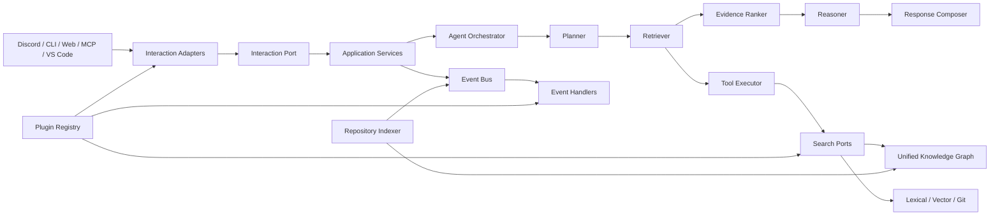

# システムアーキテクチャ

## 方針

CodeAtlas は Modular Monolith の Ports and Adapters から開始する。Agent、Knowledge Graph、Plugin、Event、Interaction の境界を内部モジュールとして固定し、実行形態は必要になるまで分散させない。

## レイヤと依存方向

| レイヤ | 責務 | 依存可能な方向 |
| --- | --- | --- |
| Domain | Entity、Value Object、event、policy、port | 標準ライブラリを基本 |
| Application | use case、Agent Pipeline、索引、event handler | Domain |
| Plugin API | 安定した拡張契約、capability、lifecycle | Domain の公開契約 |
| Adapters | UI、Git、Model、DB、検索、event transport | Application/Domain port |
| Entrypoints | process lifecycle、composition root | Application、Plugin Registry |

Domain は Discord、FastAPI、SQLAlchemy、Provider SDK、Plugin実装を import しない。

## Agent Pipeline

Orchestrator は pipeline state、iteration、token/tool budget、deadline、cancel、失敗分類だけを管理し、知的責務を持たない。

| Component | 入力 | 責務 | 出力 |
| --- | --- | --- | --- |
| Planner | canonical query、会話、capability catalog | 調査課題と検索計画を作る | `InvestigationPlan` |
| Retriever | plan、search ports | 複数検索を実行し根拠候補を正規化 | `EvidenceCandidate[]` |
| Evidence Ranker | query、候補 | relevance、authority、freshness、diversity、provenanceを評価 | `RankedEvidenceSet` |
| Reasoner | plan、ranked evidence | 事実、推論、不明点、矛盾を分離して結論を作る | `ReasoningResult` |
| Response Composer | reasoning、UI capability、locale | citation付き応答をチャネル非依存形式へ整形 | `CanonicalResponse` |

各段階は typed port として差し替え可能にする。Reasoner は検索 Tool を直接実行せず、追加調査は `RetrievalGap` をOrchestratorへ返し再計画させる。Response Composer は新しい事実を追加してはならない。

## UI 非依存 Interaction

Inbound Adapter は Discord event や HTTP request を `CanonicalInteraction` に変換する。Application は `InteractionPort` のみを使用し、応答は `CanonicalResponse` と `PresentationHints` で返す。

- `CanonicalInteraction`: actor、conversation、message、attachments、locale、capabilities、idempotency key
- `CanonicalResponse`: blocks、citations、status、follow-up hints、safe error
- `InteractionCapabilities`: max length、markdown、streaming、typing、attachments、threads
- `PresentationPolicy`: 分割、コードブロック、UI固有mention/リンクへの変換

Discord、CLI、Web API、管理画面、MCP、VS Code は同格のInteraction Pluginとし、applicationに条件分岐を持ち込まない。

## Unified Knowledge Graph

Graph はTypeScript、Thrift、Git History、Call Graph、Dependency Graphを別ストアに分断せず、snapshot-scoped identity と provenance を持つ共通モデルへ統合する。詳細は [KNOWLEDGE_GRAPH.md](KNOWLEDGE_GRAPH.md) を参照する。

## Plugin と Event

Plugin は capability-based registry で明示的にロードし、任意コードを動的取得しない。Domain Eventはin-processで同期記録され、外部副作用はtransactional outboxから非同期配送する。詳細は [PLUGINS_AND_EVENTS.md](PLUGINS_AND_EVENTS.md) を参照する。

## 質問応答フロー

1. Interaction Adapterが入力を正規化しidempotencyを検証する。
2. Application Serviceがconversation lockを取得し`InteractionReceived`を記録する。
3. Orchestratorが5段階のAgent Pipelineをbudget内で実行する。
4. RetrieverはTool Executor経由でsearch/KG/plugin capabilityを使用する。
5. RankerがSHA整合性、provenance、重複、矛盾を評価する。
6. Reasonerがverified factとinferenceを分離する。
7. ComposerがUI能力に適合するcanonical responseを作る。
8. Interaction Adapterが表示変換し、`ResponsePublished`を記録する。

## 索引更新フロー

1. Webhookを検証しdelivery IDで冪等登録する。
2. repository lockを取得し対象SHAをverifyする。
3. Parser PluginがTS/Thrift/Git artifactを共通graph mutationへ変換する。
4. 新generationへ変更とtombstoneを反映する。
5. 整合性検査後active generationをatomicに切り替える。
6. `SnapshotActivated`をoutboxへ保存し、派生索引更新を配送する。

## 一貫性と観測性

SQLiteをsource of truth、Qdrant等を再構築可能なprojectionとする。event envelopeにはevent、correlation、causation、repository、snapshot、plugin IDを持たせる。ログには秘密、repository本文、会話全文を既定で出さない。

## 0.1.0の実装状況

| Component | 実装 | 場所 |
| --- | --- | --- |
| Interaction Adapter | Discord、diagnostic CLI | `adapters/discord/`、`entrypoints/cli.py` |
| Interaction Application Service | idempotency、conversation lock、safe failure | `application/interactions.py` |
| Agent Orchestrator | budget、deadline、replan、失敗分類 | `application/agent/orchestrator.py` |
| Planner | deterministic heuristic | `application/agent/planner.py` |
| Retriever | Tool Executor経由のbounded retrieval | `application/agent/retriever.py` |
| Evidence Ranker | deterministic scoring/diversity | `application/agent/ranker.py` |
| Reasoner | Ollama + extractive fallback | `application/agent/reasoner.py` |
| Response Composer | citation付きcanonical response | `application/agent/composer.py` |
| Tool Executor | strict validation、scope、timeout、payload上限 | `application/tools/executor.py` |
| Model Provider | Ollama | `adapters/model/` |
| Repository Provider | local Git | `adapters/repository/` |
| Knowledge Graph / Index | SQLite symbols/relations/text | `infrastructure/indexing/` |
| Conversation Memory | SQLite messages/idempotency/locks | `infrastructure/conversation/` |
| Composition Root | adapter配線とlifecycle | `runtime.py` |

未実装: FastAPI Web API、MCP、VS Code、GitHub API/Webhook、Qdrant、event outbox、Thrift parser。Composition root以外は具象adapterをimportしない。
